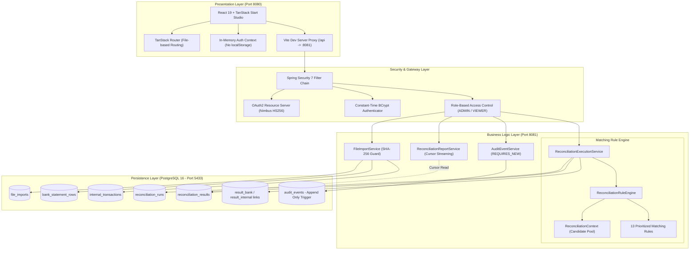
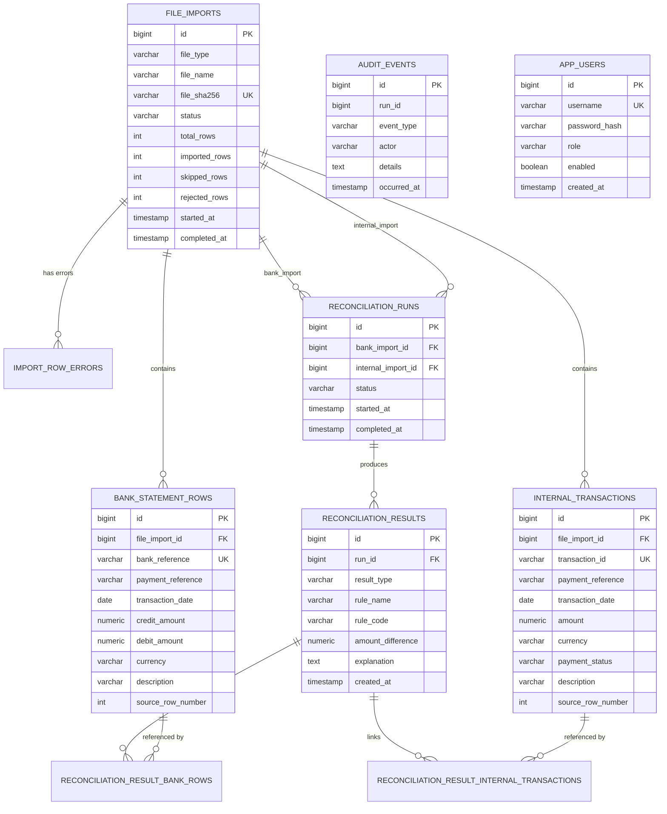
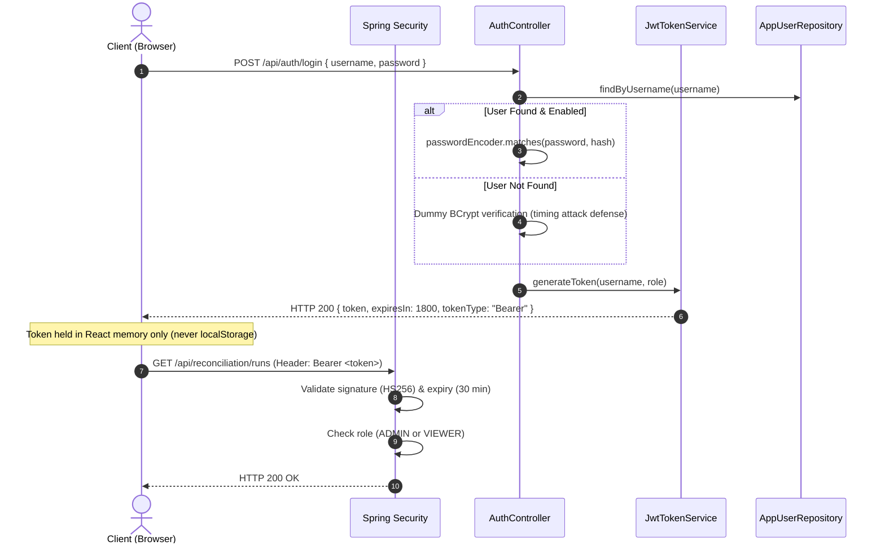

# ReconcileX - System Architecture Specification

This document provides a detailed architectural breakdown of the **ReconcileX Payment Reconciliation Engine**, detailing the structural layers, database schema, security model, and performance characteristics.

---

## 1. Architectural Principles

ReconcileX is engineered around four core tenets:
1. **Determinism:** Given the same set of bank statements and internal transactions, the engine guarantees identical reconciliation outcomes regardless of execution time or concurrency.
2. **Idempotency:** Re-submitting identical datasets will never result in duplicate records, fragmented totals, or corrupted accounting ledgers.
3. **Auditability:** Every state transition, execution decision, and file ingestion event is permanently recorded in an append-only audit trail protected by database triggers.
4. **Memory Efficiency:** Large-scale dataset exports are delivered via PostgreSQL server-side cursor streaming (`fetchSize = 500`) to maintain a bounded JVM memory footprint.

---

## 2. Layered Architecture



---

## 3. Database Schema & Entity Relationship Diagram (ERD)

Database schema migrations are managed via **Flyway (V1–V5)**.



### Schema Integrity & Constraints
1. **Idempotency Fingerprint:** `file_imports.file_sha256` is marked `UNIQUE`. Duplicate uploads are rejected before row parsing.
2. **Natural Reference Keys:** `bank_statement_rows.bank_reference` and `internal_transactions.transaction_id` enforce database-level uniqueness.
3. **Immutable Audit Trigger:** The `audit_events` table contains a PostgreSQL trigger function (`prevent_audit_modification`) that forbids any `UPDATE` or `DELETE` query, raising an SQL exception.

---

## 4. Rule Engine Subsystem

The rule engine operates on an in-memory `ReconciliationContext`.

### 1. Ingestion into Candidate Pools
When a run begins, candidates from `bank_statement_rows` and `internal_transactions` are loaded into indexed lookup maps:
* `internalByReference`: Map from `paymentReference` to list of internal transactions.
* `bankByReference`: Map from `paymentReference` to list of bank rows.
* `unmatchedInternal`: Set of all active candidate internal transaction IDs.
* `unmatchedBank`: Set of all active candidate bank row IDs.

### 2. Multi-Pass Execution Loop
Each rule implements the `MatchingRule` interface:
```java
public interface MatchingRule extends Ordered {
    List<MatchOutcome> match(ReconciliationContext context);
}
```
Rules evaluate candidate records in strict numeric order (`getOrder()`). When a match is found:
1. A `MatchOutcome` record is generated.
2. The participating internal IDs and bank IDs are **removed** from `context.getUnmatchedInternal()` and `context.getUnmatchedBank()`.
3. Subsequent passes only evaluate the remaining candidates.

### 3. Batch Persistence
Results and N:M join linkages (`reconciliation_result_bank_rows`, `reconciliation_result_internal_transactions`) are persisted using JDBC batch updates (`rewriteBatchedStatements=true`), reducing round-trip latency.

---

## 5. Security & Authentication Architecture

ReconcileX enforces an **authenticated-by-default (Default Deny)** posture.



### Security Defenses
* **Timing-Attack Countermeasure:** `AuthService` computes a dummy BCrypt hash when an invalid username is queried, ensuring that authentication failures take uniform execution time regardless of whether the username exists.
* **In-Memory JWT Storage:** In the React frontend, JWTs are held exclusively in React state. They are never written to `localStorage` or `sessionStorage`, mitigating Cross-Site Scripting (XSS) credential theft.
* **CSV Formula Injection Shield:** Output cells beginning with `=, +, -, @, \t, \r` are escaped with a leading single quote (`'`) to prevent formula execution in spreadsheet applications.

---

## 6. Performance & Memory Management

### Cursor-Based Streaming Architecture
Generating large CSV reports can easily exhaust JVM heap memory if thousands of entities are loaded into memory simultaneously.

ReconcileX overcomes this using **PostgreSQL server-side cursors**:
1. `ReconciliationReportService` opens a read-only Spring transaction (`@Transactional(readOnly = true)`).
2. The JDBC `Statement` is configured with `fetchSize = 500`.
3. Rows are streamed directly into Spring WebMVC's `StreamingResponseBody` or `ResponseBodyEmitter`.
4. As chunks are written to the HTTP socket, memory is immediately eligible for garbage collection.

### Numerical Precision Guarantee
Binary floating-point arithmetic (`double`, `float`) is susceptible to IEEE-754 precision issues (e.g. `0.1 + 0.2 != 0.3`).
* Every financial value in ReconcileX is strictly represented as `java.math.BigDecimal`.
* Currencies enforce scale `2` and `RoundingMode.HALF_UP`.
