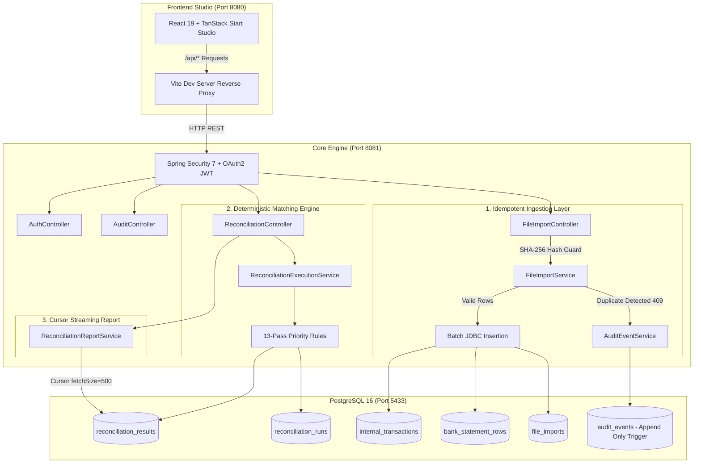
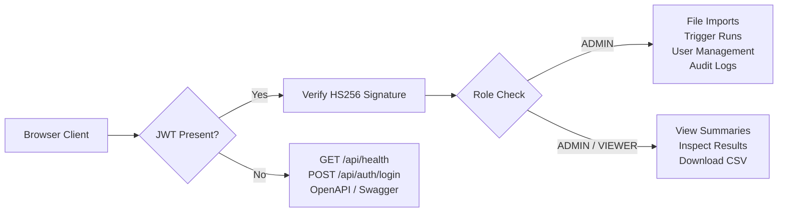

# ReconcileX - Automated Financial Transaction Reconciliation Engine

ReconcileX is a high-throughput, deterministic transaction reconciliation platform engineered for fintech, banking, and payment gateway ecosystems. It ingests high-volume bank statements and internal ledgers, executes prioritized multi-pass deterministic matching rules, tracks an immutable audit trail, and generates streaming reconciliation reports with low memory overhead.

The platform includes a modern **React 19 / TanStack Start Studio** frontend on port `8080` and a **Spring Boot 4 / Java 21** core backend on port `8081` powered by **PostgreSQL 16**.

---

## 1. System Architecture & High-Level Overview



---

## 2. The 13 Deterministic Matching Rules

Transactions are evaluated sequentially in strict precedence order. When a transaction matches a rule, it is consumed from the matching context to prevent contradictory classifications.

| Order | Rule Class | Result Classification | Description |
| :---: | :--- | :--- | :--- |
| **10** | `FailedStatusRule` | `IGNORED_FAILED_STATUS` | Internal rows marked FAILED/CANCELLED without bank debit are excluded from discrepancy alarms. |
| **50** | `InternalDuplicateRule` | `INTERNAL_DUPLICATE_DETECTED` | Multiple internal ledger records with identical payment references. |
| **100** | `ExactMatchRule` | `EXACT_MATCH` | Identical external reference, amount, and transaction date. |
| **200** | `DateToleranceRule` | `DATE_MISMATCH` | Identical reference and amount, but bank settlement delayed by 1–3 days. |
| **300** | `AmountMismatchRule` | `AMOUNT_MISMATCH` | Identical external reference and date, but amount differs (e.g. gateway commission). |
| **350** | `BankDuplicateRule` | `BANK_DUPLICATE_DETECTED` | Duplicate bank statement entries with identical bank reference numbers. |
| **400** | `BatchSettlementRule` | `BATCH_SETTLEMENT` | One aggregate bank payout settlement covering multiple internal ledger transactions. |
| **500** | `RefundRule` | `REFUND_MATCH` / `REFUND_PENDING_BANK` | Reversal/refund records matched against credit/debit adjustments. |
| **600** | `ServiceChargeRule` | `BANK_SERVICE_CHARGE` | Automatic detection of bank maintenance, IMPS, SMS, and folio charges. |
| **900** | `UnexpectedDebitRule` | `UNEXPECTED_BANK_DEBIT` | Unrecognized bank account debits, disputes, or chargebacks. |
| **910** | `MissingInBankRule` | `MISSING_IN_BANK` | Unmatched internal ledger transactions that never arrived in the bank. |
| **920** | `MissingInInternalRule` | `MISSING_IN_INTERNAL` | Unmatched bank statement deposits with no corresponding internal order. |

---

## 3. Security Model & Role-Based Access Control

* **Stateless HS256 JWT**: Signed with a minimum 256-bit secret, 30-minute expiration.
* **In-Memory Token Storage**: Strict financial compliance — tokens are stored strictly in-memory in React state (`useState`) and never exposed in `localStorage` or `sessionStorage`.
* **Constant-Time BCrypt Verification**: Timing attack defense — unknown usernames execute dummy BCrypt calculations to prevent user enumeration.
* **Role Separation**:
  * **`ADMIN`**: Full permissions (`POST /api/imports/*`, `POST /api/reconciliation/runs`, `GET /api/audit-events`).
  * **`VIEWER`**: Read-only permissions (`GET /api/reconciliation/runs/*`, `GET /api/reconciliation/runs/{id}/report.csv`).



---

## 4. Quickstart Guide

### Option A: Local Development (Recommended)

1. **Start Backend & Database**:
   ```powershell
   # Bootstraps PostgreSQL in Docker and starts Spring Boot on port 8081
   .\scripts\run-local.ps1
   ```

2. **Start Frontend Studio**:
   ```powershell
   cd frontend
   pnpm run dev
   ```
   * Access the frontend studio at **`http://localhost:8080/`**.
   * Access Swagger UI documentation at **`http://localhost:8081/swagger-ui/index.html`**.
   * Access the OpenAPI specification at **`http://localhost:8081/v3/api-docs`**.

### Option B: Docker Compose

1. Copy `.env.example` to `.env`:
   ```bash
   cp .env.example .env
   ```
2. Build and start containers:
   ```bash
   docker compose up --build -d
   ```
3. Test backend health:
   ```bash
   curl http://localhost:8081/api/health
   ```

---

## 5. API Reference & cURL Commands

### 1. Authenticate & Obtain JWT
```bash
curl -X POST http://localhost:8081/api/auth/login \
  -H "Content-Type: application/json" \
  -d '{"username":"admin","password":"your_admin_password"}'
```

### 2. Ingest Bank Statement & Internal Ledger (ADMIN)
```bash
export TOKEN="your_jwt_token_here"

# Upload Bank Statement (CSV)
curl -X POST http://localhost:8081/api/imports/bank \
  -H "Authorization: Bearer $TOKEN" \
  -F "file=@sample-data/bank_statement.csv"

# Upload Internal Ledger (CSV)
curl -X POST http://localhost:8081/api/imports/internal \
  -H "Authorization: Bearer $TOKEN" \
  -F "file=@sample-data/internal_transactions.csv"
```

### 3. Trigger Reconciliation Run (ADMIN)
```bash
curl -X POST http://localhost:8081/api/reconciliation/runs \
  -H "Authorization: Bearer $TOKEN" \
  -H "Content-Type: application/json" \
  -d '{"bankImportId":1,"internalImportId":2}'
```

### 4. Fetch Financial Summary & Stream CSV Report (ADMIN / VIEWER)
```bash
# Get financial summary
curl -X GET http://localhost:8081/api/reconciliation/runs/1/summary \
  -H "Authorization: Bearer $TOKEN"

# Stream CSV report directly to file
curl -X GET http://localhost:8081/api/reconciliation/runs/1/report.csv \
  -H "Authorization: Bearer $TOKEN" \
  -o reconciliation_report.csv
```

### 5. Inspect Audit Trail (ADMIN)
```bash
curl -X GET "http://localhost:8081/api/audit-events?runId=1&page=0&size=20" \
  -H "Authorization: Bearer $TOKEN"
```

---

## 6. Running Tests

### Backend Test Suite (85 Tests)
```powershell
.\mvnw.cmd clean test
```
* Runs unit tests, rule tests, repository integration tests, security authorization tests, and CSV streaming tests against Testcontainers PostgreSQL.

### Frontend Test Suite & Strict Type Check
```powershell
cd frontend
pnpm test               # Runs Vitest routing and component tests
pnpm exec tsc --noEmit  # Full TypeScript strictness validation
pnpm build              # Production bundle build
```

---

## 7. Performance Benchmarks (50,000-Row Load Test)

The benchmark is tagged `@Tag("benchmark")` and is excluded from the default test run. To run the benchmark:
```powershell
.\mvnw.cmd clean test -P benchmark
```

| Pipeline Stage | 100k Input Dataset (50k Bank + 50k Internal) | Throughput |
| :--- | :---: | :---: |
| **Bank Import** | 11,025 ms | ~4,535 rows/sec |
| **Internal Import** | 10,397 ms | ~4,809 rows/sec |
| **Reconciliation Matching (13 Rules)** | 45,064 ms | ~2,219 rows/sec |
| **Streaming CSV Export (59,000 Rows)** | 501 ms | ~11.5 MB/sec |
| **Streaming Memory Peak** | 343.66 MB | Low-overhead cursor streaming |

*Detailed benchmark methodology and logs are available in [docs/performance.md](docs/performance.md).*

---

## 8. Detailed Documentation

* [ARCHITECTURE.md](ARCHITECTURE.md) — Technical deep-dive into the database schema, design decisions, and system components.
* [WORKFLOW.md](WORKFLOW.md) — Comprehensive end-to-end data lifecycle, multi-pass matching flowcharts, and sequence diagrams.
* [docs/performance.md](docs/performance.md) — Benchmark reports and memory profiling.
