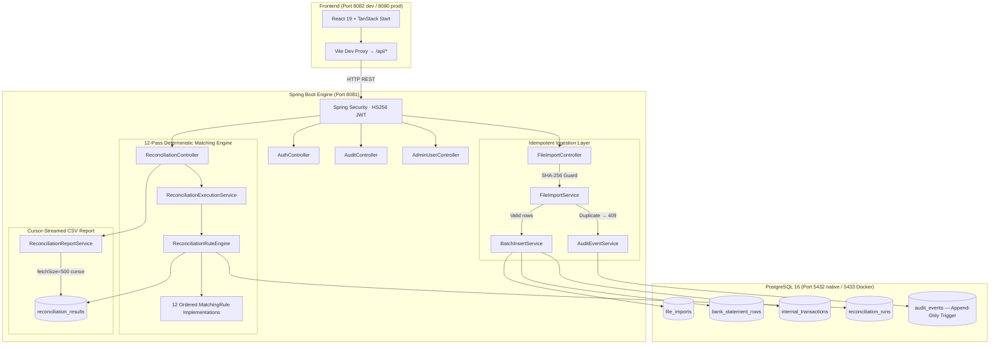

# ReconcileX — Automated Financial Transaction Reconciliation Engine

ReconcileX is a full-stack, deterministic financial reconciliation platform built for fintech, banking, and payment gateway environments. It ingests external bank statements and internal accounting ledgers as CSV files, executes a sequential 12-pass deterministic matching pipeline, maintains an append-only PostgreSQL audit trail, and streams paginated reconciliation reports in INR.

---

## Tech Stack

| Layer | Technology |
| :--- | :--- |
| **Backend** | Spring Boot 4.1.1, Java 21, Spring Security + OAuth2 JWT |
| **Database** | PostgreSQL 16, Flyway schema migrations |
| **Frontend** | React 19, TanStack Router, TanStack Start, Tailwind CSS v4 |
| **Build** | Maven Wrapper (`mvnw`), pnpm, Vite 8 |
| **Deployment** | Docker multi-stage build, Docker Compose, Nitro (Cloudflare Workers) |
| **Tests** | JUnit 5, Testcontainers, Vitest |
| **API Docs** | SpringDoc OpenAPI 3 / Swagger UI |

---

## 1. System Architecture



---

## 2. The 12 Deterministic Matching Rules

Transactions are evaluated sequentially in strict precedence order. When a transaction satisfies a rule, it is consumed from the matching context to prevent contradictory classifications.

| Order | Rule Class | Result Type | Description |
| :---: | :--- | :--- | :--- |
| **10** | `FailedStatusRule` | `IGNORED_FAILED_STATUS` | Internal rows with FAILED or CANCELLED status and no bank debit are excluded from discrepancy alarms. |
| **50** | `InternalDuplicateRule` | `INTERNAL_DUPLICATE_DETECTED` | Multiple internal ledger records sharing the same payment reference. |
| **100** | `ExactMatchRule` | `EXACT_MATCH` | Identical payment reference, exact amount (INR), and matching transaction date. |
| **200** | `DateToleranceRule` | `DATE_MISMATCH` | Identical reference and amount; bank settlement date differs by 1–3 days (configurable window). |
| **300** | `AmountMismatchRule` | `AMOUNT_MISMATCH` | Matching reference and date; amount differs (e.g., payment gateway commission deductions). |
| **350** | `BankDuplicateRule` | `BANK_DUPLICATE_DETECTED` | Duplicate bank statement entries sharing the same bank reference identifier. |
| **400** | `BatchSettlementRule` | `BATCH_SETTLEMENT` | One aggregate bank credit payout matching multiple internal ledger transactions via settlement reference. |
| **500** | `RefundRule` | `REFUND_MATCH` / `REFUND_PENDING_BANK` | Reversal or refund transactions matched against credit or debit adjustments. |
| **600** | `ServiceChargeRule` | `BANK_SERVICE_CHARGE` | Automatic identification of bank maintenance fees, IMPS charges, SMS alerts, and folio costs. |
| **900** | `UnexpectedDebitRule` | `UNEXPECTED_BANK_DEBIT` | Unrecognized bank account debits, disputes, or chargebacks with no internal record. |
| **910** | `MissingInBankRule` | `MISSING_IN_BANK` | Internal ledger order recorded as successful but never credited by the banking partner. |
| **920** | `MissingInInternalRule` | `MISSING_IN_INTERNAL` | Bank statement deposit or credit with no corresponding internal order or invoice record. |

---

## 3. CSV File Schemas

### Bank Statement (`POST /api/imports/bank`)

| Column | Type | Required |
| :--- | :--- | :---: |
| `transaction_date` | `DATE (YYYY-MM-DD)` | ✓ |
| `bank_reference` | `VARCHAR(120)` | ✓ |
| `payment_reference` | `VARCHAR(120)` | ✓ |
| `settlement_reference` | `VARCHAR(120)` | ✓ |
| `description` | `TEXT` | ✓ |
| `credit_amount` | `NUMERIC(19,2) ≥ 0` | ✓ |
| `debit_amount` | `NUMERIC(19,2) ≥ 0` | ✓ |
| `currency` | `VARCHAR(3)` (e.g. `INR`) | ✓ |

### Internal Ledger (`POST /api/imports/internal`)

| Column | Type | Required |
| :--- | :--- | :---: |
| `transaction_id` | `VARCHAR(100)` (unique) | ✓ |
| `payment_reference` | `VARCHAR(120)` | ✓ |
| `transaction_date` | `DATE (YYYY-MM-DD)` | ✓ |
| `description` | `TEXT` | ✓ |
| `amount` | `NUMERIC(19,2) ≥ 0` | ✓ |
| `currency` | `VARCHAR(3)` | ✓ |
| `payment_status` | `SUCCESS\|PENDING\|FAILED\|REFUNDED\|REFUND_INITIATED` | ✓ |
| `settlement_reference` | `VARCHAR(120)` | ✓ |

---

## 4. Security Model & Role-Based Access Control

| Feature | Detail |
| :--- | :--- |
| **Algorithm** | HS256 JWT signed with a minimum 256-bit secret |
| **Token Expiry** | 30 minutes (configurable via `JWT_EXPIRATION_MS`) |
| **Token Storage** | In-memory only (`useState` in React) — never `localStorage` or `sessionStorage` |
| **User Enumeration Defense** | Unknown usernames execute a dummy BCrypt verification to prevent timing-based enumeration |

### Endpoint Authorization

| Endpoint | `ADMIN` | `VIEWER` | Guest |
| :--- | :---: | :---: | :---: |
| `POST /api/auth/login` | ✓ | ✓ | ✓ |
| `GET /api/health` | ✓ | ✓ | ✓ |
| `POST /api/imports/bank` | ✓ | — | — |
| `POST /api/imports/internal` | ✓ | — | — |
| `POST /api/reconciliation/runs` | ✓ | — | — |
| `GET /api/reconciliation/runs` | ✓ | ✓ | — |
| `GET /api/reconciliation/runs/{id}/summary` | ✓ | ✓ | — |
| `GET /api/reconciliation/runs/{id}/results` | ✓ | ✓ | — |
| `GET /api/reconciliation/runs/{id}/report.csv` | ✓ | ✓ | — |
| `GET /api/audit-events` | ✓ | — | — |
| `GET /api/admin/users` | ✓ | — | — |
| `POST /api/admin/users` | ✓ | — | — |

---

## 5. Database Schema

The schema is managed by Flyway migration (`V1__create_reconciliation_schema.sql`). Key tables:

```
file_imports            — Upload records with SHA-256 hash and idempotency constraint
bank_statement_rows     — Parsed external bank statement rows (linked to file_imports)
internal_transactions   — Parsed internal ledger rows (linked to file_imports)
reconciliation_runs     — Execution records (PENDING → RUNNING → COMPLETED/FAILED)
reconciliation_results  — Individual match outcomes per run (one row per classified transaction)
audit_events            — Append-only compliance log (INSERT-only enforced by PostgreSQL trigger)
app_users               — Application accounts (username, BCrypt password_hash, role)
```

The `audit_events` table enforces strict append-only behaviour via a PostgreSQL trigger that blocks all `UPDATE` and `DELETE` operations.

---

## 6. Quickstart

### Option A — Local Development (Recommended)

**Prerequisites**: Java 21, Maven, PostgreSQL 16 running locally, Node.js 20+, pnpm.

```powershell
# 1. Start Spring Boot backend (port 8081)
cd reconcilex
.\scripts\run-local.ps1

# 2. In a new terminal, start frontend dev server (port 8082)
cd reconcilex\frontend
pnpm install
pnpm run dev
```

- Frontend: `http://localhost:8082/`
- Swagger UI: `http://localhost:8081/swagger-ui/index.html`
- OpenAPI spec: `http://localhost:8081/v3/api-docs`
- Backend health: `http://localhost:8081/api/health`

### Option B — Docker Compose

```bash
# 1. Copy environment file
cp .env.example .env

# 2. Edit .env with your secrets (JWT_SECRET, DB_PASSWORD, APP_ADMIN_PASSWORD)

# 3. Build and start
docker compose up --build -d

# 4. Verify backend health
curl http://localhost:8081/api/health
```

---

## 7. API Reference

### Authenticate

```bash
curl -X POST http://localhost:8081/api/auth/login \
  -H "Content-Type: application/json" \
  -d '{"username":"admin","password":"your_admin_password"}'
```

### Ingest Files (ADMIN)

```bash
export TOKEN="<jwt_from_login>"

# Bank statement
curl -X POST http://localhost:8081/api/imports/bank \
  -H "Authorization: Bearer $TOKEN" \
  -F "file=@sample-data/bank_statement.csv"

# Internal ledger
curl -X POST http://localhost:8081/api/imports/internal \
  -H "Authorization: Bearer $TOKEN" \
  -F "file=@sample-data/internal_transactions.csv"
```

> Uploading the same file a second time returns HTTP **409 Conflict** with the original Import ID — safe to re-upload without double-counting.

### Execute Reconciliation Run (ADMIN)

```bash
curl -X POST http://localhost:8081/api/reconciliation/runs \
  -H "Authorization: Bearer $TOKEN" \
  -H "Content-Type: application/json" \
  -d '{"bankImportId":1,"internalImportId":2}'
```

### Fetch Results (ADMIN / VIEWER)

```bash
# Financial summary for run 1
curl http://localhost:8081/api/reconciliation/runs/1/summary \
  -H "Authorization: Bearer $TOKEN"

# Paginated transaction outcomes
curl "http://localhost:8081/api/reconciliation/runs/1/results?page=0&size=50" \
  -H "Authorization: Bearer $TOKEN"

# Stream full CSV report to file
curl http://localhost:8081/api/reconciliation/runs/1/report.csv \
  -H "Authorization: Bearer $TOKEN" \
  -o reconciliation_report.csv
```

### Audit Trail (ADMIN)

```bash
curl "http://localhost:8081/api/audit-events?page=0&size=20" \
  -H "Authorization: Bearer $TOKEN"

# Filter by event type
curl "http://localhost:8081/api/audit-events?eventType=RUN_COMPLETED&page=0&size=20" \
  -H "Authorization: Bearer $TOKEN"
```

### User Management (ADMIN)

```bash
# List all application users
curl http://localhost:8081/api/admin/users \
  -H "Authorization: Bearer $TOKEN"

# Create a new VIEWER account
curl -X POST http://localhost:8081/api/admin/users \
  -H "Authorization: Bearer $TOKEN" \
  -H "Content-Type: application/json" \
  -d '{"username":"analyst1","password":"SecurePass@123","role":"VIEWER"}'
```

---

## 8. Running Tests

### Backend Test Suite

```powershell
# All unit tests (35 tests, no Docker required)
.\mvnw.cmd clean test -Dexclude="**/*IntegrationTest.java,**/*Benchmark*.java"

# Full suite including Testcontainers integration tests (requires Docker)
.\mvnw.cmd clean test

# Performance benchmark (50k rows, tagged @Tag("benchmark"))
.\mvnw.cmd clean test -P benchmark
```

Test classes:
- `MatchingRulesUnitTest` — all 12 rule implementations
- `Phase4RulesUnitTest` — batch settlement and refund rules
- `CsvRowValidatorTest` — CSV header and row validation
- `ReconcilexRepositoryTests` — repository layer
- `SecurityIntegrationTest` — JWT and RBAC endpoint authorization
- `FileImportIntegrationTest` — SHA-256 duplicate detection
- `ReconciliationIntegrationTest` — end-to-end matching pipeline
- `Phase5IntegrationTest` — streaming report and audit trail

### Frontend Test Suite

```powershell
cd frontend

pnpm exec tsc --noEmit    # TypeScript strict check (0 errors)
pnpm test                  # Vitest (17 tests, 3 suites)
pnpm run build             # Production bundle (Nitro + Vite)
```

Test files:
- `content-accuracy.test.ts` — matching rules constants and CSV headers (5 tests)
- `auth-and-rbac.test.ts` — JWT decode, role gates, session expiry (11 tests)
- `app-routing.test.tsx` — route rendering and navigation (1 test)

---

## 9. Performance Benchmarks (100k-Row Load Test)

The benchmark suite is tagged `@Tag("benchmark")` and excluded from the default test run.

| Pipeline Stage | Dataset | Result |
| :--- | :---: | :---: |
| Bank Statement Import | 50,000 rows | ~11 seconds |
| Internal Ledger Import | 50,000 rows | ~10.4 seconds |
| 12-Pass Matching Engine | 100,000 total rows | ~45 seconds |
| Streaming CSV Export | 59,000 result rows | ~500 ms |
| Peak Heap Memory | — | ~344 MB |

> CSV reports are streamed using a JDBC cursor (`fetchSize=500`), keeping memory overhead constant regardless of result set size.

---

## 10. Project Structure

```
reconcilex/
├── src/
│   ├── main/
│   │   ├── java/com/reconcilex/
│   │   │   ├── config/          # Security, JWT, OpenAPI, MatchingProperties
│   │   │   ├── controller/      # REST controllers (Auth, Import, Reconciliation, Audit, Admin)
│   │   │   ├── dto/             # Request and response DTOs
│   │   │   ├── entity/          # JPA entities and enums
│   │   │   ├── exception/       # GlobalExceptionHandler, custom exceptions
│   │   │   ├── repository/      # Spring Data JPA repositories
│   │   │   ├── rules/           # 12 MatchingRule implementations + RuleEngine
│   │   │   └── service/         # Business services (Import, Reconciliation, Report, Audit, JWT)
│   │   └── resources/
│   │       ├── application.properties
│   │       └── db/migration/    # Flyway V1 schema
│   └── test/
│       └── java/com/reconcilex/ # Unit, integration, and benchmark tests
├── frontend/                    # React 19 frontend (see frontend/README.md)
├── scripts/                     # run-local.ps1, start-all.ps1, smoke-test.ps1
├── Dockerfile                   # Multi-stage eclipse-temurin:21 build
├── docker-compose.yml           # PostgreSQL 16 + Spring Boot services
├── pom.xml                      # Maven build configuration
└── .env.example                 # Environment variable template
```

---

## 11. Audit Event Types

The following event types are recorded in the append-only `audit_events` table:

| Event Type | Trigger |
| :--- | :--- |
| `RUN_STARTED` | A reconciliation run begins execution |
| `RUN_COMPLETED` | A run finishes successfully |
| `RUN_FAILED` | A run fails mid-execution |
| `IMPORT_STARTED` | A file import begins parsing |
| `IMPORT_COMPLETED` | A file import finishes successfully |
| `IMPORT_FAILED` | A file import fails validation |
| `IMPORT_DUPLICATE_REJECTED` | An already-imported file (same SHA-256) is rejected (HTTP 409) |
| `MATCH_DECISION` | A matching rule classifies a transaction |
| `USER_CREATED` | A new application user account is provisioned |
| `LOGIN_FAILED` | A login attempt fails (username only; never logs passwords) |

> **Note**: Successful logins are not currently recorded in the audit trail. Only `LOGIN_FAILED` and `USER_CREATED` administrative events are persisted.

---

## 12. Environment Variables

| Variable | Description | Example |
| :--- | :--- | :--- |
| `DB_URL` | PostgreSQL JDBC URL | `jdbc:postgresql://localhost:5432/reconcilex` |
| `DB_USERNAME` | Database username | `reconcilex_user` |
| `DB_PASSWORD` | Database password | *(your password)* |
| `DB_NAME` | Database name | `reconcilex` |
| `DB_PORT` | Host-mapped database port | `5433` |
| `JWT_SECRET` | HS256 signing key (≥ 256 bits) | *(random 64-char hex)* |
| `JWT_EXPIRATION_MS` | Token lifetime in milliseconds | `1800000` (30 min) |
| `APP_ADMIN_USERNAME` | Bootstrap admin username | `admin` |
| `APP_ADMIN_PASSWORD` | Bootstrap admin password | *(strong password)* |
| `SERVER_PORT` | Spring Boot server port | `8081` |
| `DATE_TOLERANCE_DAYS` | Configurable date window for DateToleranceRule | `3` |
| `VITE_API_URL` | Frontend API base URL (production) | `https://your-backend.example.com` |

---

## 13. Technical Documentation Index

For in-depth architectural and operational guides, see:

* **[ARCHITECTURE.md](ARCHITECTURE.md)** — Comprehensive technical specification: layered design, full database ERD, candidate pool matching engine, security posture, and server-side cursor streaming.
* **[WORKFLOW.md](WORKFLOW.md)** — End-to-end data lifecycle: state diagrams, sequence diagrams for authentication and SHA-256 idempotency, candidate consumption mechanics, and audit log persistence.
* **[docs/performance.md](docs/performance.md)** — Empirical 100,000-row load benchmark report, hardware specs, throughput calculations, and heap memory profiling.
* **[frontend/README.md](frontend/README.md)** — Frontend engineering guide: component architecture, in-memory JWT security, single source of truth (`matching-rules.ts`), responsive breakpoints, and Nitro production build.

