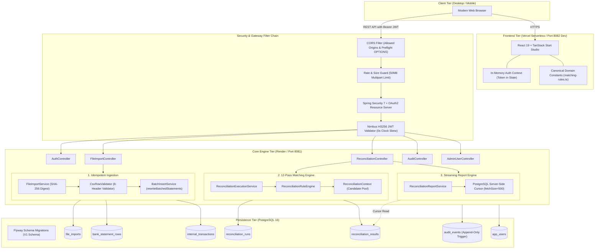
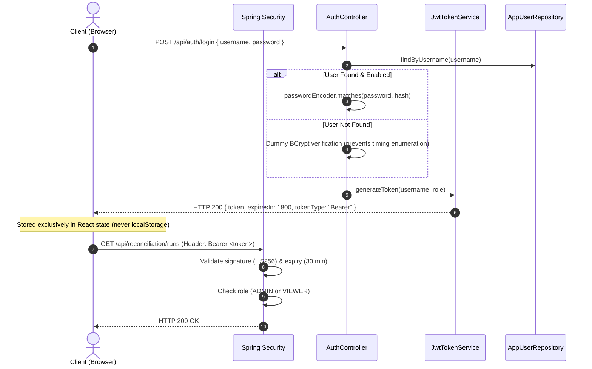
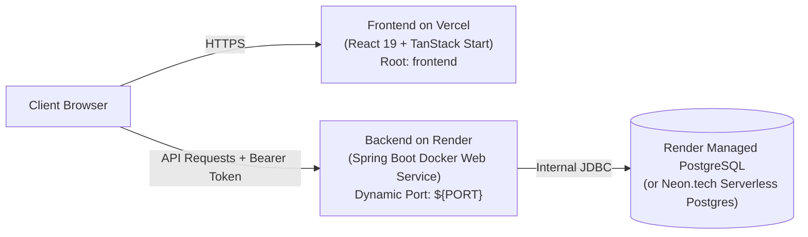

# ReconcileX — Automated Financial Transaction Reconciliation Engine

[](https://adoptium.net/)
[](https://spring.io/projects/spring-boot)
[](https://react.dev/)
[](https://tailwindcss.com/)
[](https://www.postgresql.org/)
[](LICENSE)

ReconcileX is a high-performance, deterministic financial transaction reconciliation engine and modern enterprise workstation. Built for fintech companies, banks, and payment aggregators, it automates the ingestion of external banking partner statements and internal ledger records, processes them through a 12-pass deterministic rule pipeline, maintains an append-only compliance audit trail, and generates streamed variance reports in Indian Rupees (INR).

---

## Table of Contents

1. [Project Overview & Problem Statement](#1-project-overview--problem-statement)
2. [Key Capabilities & Architectural Highlights](#2-key-capabilities--architectural-highlights)
3. [End-to-End System Architecture](#3-end-to-end-system-architecture)
4. [The 12-Pass Deterministic Matching Pipeline](#4-the-12-pass-deterministic-matching-pipeline)
5. [CSV File Ingestion Schemas & Validation](#5-csv-file-ingestion-schemas--validation)
6. [Security Model & Role-Based Access Control (RBAC)](#6-security-model--role-based-access-control-rbac)
7. [Database Schema & Entity Relationship](#7-database-schema--entity-relationship)
8. [Append-Only Audit Trail System](#8-append-only-audit-trail-system)
9. [Tech Stack Specifications](#9-tech-stack-specifications)
10. [Local Development Quickstart](#10-local-development-quickstart)
11. [Production Deployment Guide (Vercel + Render + PostgreSQL)](#11-production-deployment-guide-vercel--render--postgresql)
12. [REST API Documentation & cURL Examples](#12-rest-api-documentation--curl-examples)
13. [Testing, Benchmarks & Quality Assurance](#13-testing-benchmarks--quality-assurance)
14. [Environment Variables Reference](#14-environment-variables-reference)
15. [Related Architecture & Workflow Documents](#15-related-architecture--workflow-documents)

---

## 1. Project Overview & Problem Statement

Modern fintech platforms process thousands of transactions daily across multiple payment channels (UPI, IMPS, Cards, Net Banking). Discrepancies routinely arise between what an internal order management system records and what the acquiring bank or settlement partner settles:

- **Timing Variances:** Settlements occur T+1 or T+3 business days after payment initiation.
- **Deductions & Fees:** Banks deduct merchant discount rates (MDR), IMPS fees, and folio charges.
- **Batch Payouts:** Banks settle hundreds of individual internal orders as a single lump-sum credit.
- **Refunds & Chargebacks:** Customer reversals and unexpected debits introduce ledger imbalances.
- **Unsettled Transactions:** Orders marked as successful internally that fail to credit the bank account.

### The ReconcileX Solution
ReconcileX solves this through an automated, rule-based matching engine that:
1. **Guarantees Idempotent Ingestion:** Employs SHA-256 cryptographic digests to block duplicate uploads without double-counting.
2. **Executes Ordered Deterministic Rules:** Consumes matched records pass-by-pass to eliminate ambiguous or contradictory classifications.
3. **Shields Financial Integrity:** Stores audit events with a database trigger preventing `UPDATE` and `DELETE` queries.
4. **Delivers Bounded-Memory Exports:** Utilizes server-side cursor streaming (`fetchSize=500`) to output multi-megabyte CSV reports without JVM memory spikes.

---

## 2. Key Capabilities & Architectural Highlights

- **100% In-Memory JWT Authentication:** JWT tokens reside strictly in frontend React application state. They are never written to `localStorage` or `sessionStorage`, mitigating Cross-Site Scripting (XSS) credential theft.
- **Timing-Attack Defense:** Failed authentication invokes dummy BCrypt hashing to maintain constant response times and prevent user enumeration.
- **CSV Formula Injection Shield:** Output cells starting with `=`, `+`, `-`, `@`, `\t`, or `\r` are automatically escaped with a leading single quote (`'`).
- **Exact Numeric Representation:** All monetary amounts use `java.math.BigDecimal` with scale 2 and `RoundingMode.HALF_UP` to prevent IEEE-754 floating-point inaccuracies.
- **Single Source of Truth:** Rule names, codes, CSV headers, and audit events are defined in canonical domain constants shared across the frontend and backend.
- **Fully Responsive FinTech UI:** Mobile-first responsive drawer navigation, touch-friendly filter bars, and horizontal data-table swiping.

---

## 3. End-to-End System Architecture



---

## 4. The 12-Pass Deterministic Matching Pipeline

Candidate transactions are evaluated in strict priority order (`MatchingRuleOrder`). When a candidate matches a rule, its ID is consumed from `context.getUnmatchedInternal()` and `context.getUnmatchedBank()`. Subsequent passes only evaluate the remaining unconsumed records.

| Pass | Order | Rule Class | Result Classification | Description |
| :---: | :---: | :--- | :--- | :--- |
| **1** | `10` | `FailedStatusRule` | `IGNORED_FAILED_STATUS` | Internal orders marked FAILED/CANCELLED with no bank debit are excluded from discrepancy alarms. |
| **2** | `50` | `InternalDuplicateRule` | `INTERNAL_DUPLICATE_DETECTED` | Multiple internal ledger records sharing the exact same payment reference. |
| **3** | `100` | `ExactMatchRule` | `EXACT_MATCH` | Identical payment reference, exact transaction amount, and matching transaction date in INR. |
| **4** | `200` | `DateToleranceRule` | `DATE_MISMATCH` | Identical reference and amount; bank settlement date differs within a 1–3 day configurable window. |
| **5** | `300` | `AmountMismatchRule` | `AMOUNT_MISMATCH` | Matching payment reference and date; amount differs (e.g., payment gateway commission deductions). |
| **6** | `350` | `BankDuplicateRule` | `BANK_DUPLICATE_DETECTED` | Duplicate bank statement entries sharing the same bank reference identifier. |
| **7** | `400` | `BatchSettlementRule` | `BATCH_SETTLEMENT` | One aggregate bank payout settlement covering multiple internal ledger transactions sharing settlement reference. |
| **8** | `500` | `RefundRule` | `REFUND_MATCH` / `REFUND_PENDING_BANK` | Reversal or refund transactions matched against corresponding credit or debit adjustments. |
| **9** | `600` | `ServiceChargeRule` | `BANK_SERVICE_CHARGE` | Automatic detection of bank maintenance fees, IMPS charges, SMS alerts, and folio costs. |
| **10** | `900` | `UnexpectedDebitRule` | `UNEXPECTED_BANK_DEBIT` | Unrecognized bank account debits, disputes, or chargebacks with no internal record. |
| **11** | `910` | `MissingInBankRule` | `MISSING_IN_BANK` | Internal ledger order recorded and marked successful, but never credited by the banking partner. |
| **12** | `920` | `MissingInInternalRule` | `MISSING_IN_INTERNAL` | Bank statement deposit or credit with no corresponding internal order or invoice record. |

---

## 5. CSV File Ingestion Schemas & Validation

Both uploaded datasets must conform to RFC 4180 CSV specifications and include the exact 8 required column headers.

### A. External Bank Statement (`POST /api/imports/bank`)

| Header Name | Data Type | Constraint | Description |
| :--- | :--- | :---: | :--- |
| `transaction_date` | `DATE` | `YYYY-MM-DD` | Date transaction cleared the bank account |
| `bank_reference` | `VARCHAR(120)` | Unique | Bank's internal sequence / UTR number |
| `payment_reference` | `VARCHAR(120)` | Required | Merchant payment identifier |
| `settlement_reference` | `VARCHAR(120)` | Required | Batch settlement identifier |
| `description` | `TEXT` | Optional | Bank narration (parsed for service fees) |
| `credit_amount` | `NUMERIC(19,2)` | `≥ 0` | Inbound deposit amount |
| `debit_amount` | `NUMERIC(19,2)` | `≥ 0` | Outbound withdrawal amount |
| `currency` | `VARCHAR(3)` | `INR` | Standard ISO currency code |

### B. Internal Ledger (`POST /api/imports/internal`)

| Header Name | Data Type | Constraint | Description |
| :--- | :--- | :---: | :--- |
| `transaction_id` | `VARCHAR(100)` | Unique | Internal system transaction UUID / ID |
| `payment_reference` | `VARCHAR(120)` | Required | Order reference passed to payment gateway |
| `transaction_date` | `DATE` | `YYYY-MM-DD` | Date order was placed |
| `description` | `TEXT` | Optional | Internal transaction narrative |
| `amount` | `NUMERIC(19,2)` | `≥ 0` | Gross order amount |
| `currency` | `VARCHAR(3)` | `INR` | Standard ISO currency code |
| `payment_status` | `VARCHAR(40)` | Enum | `SUCCESS`, `PENDING`, `FAILED`, `REFUNDED`, `REFUND_INITIATED` |
| `settlement_reference` | `VARCHAR(120)` | Required | Expected payout batch reference |

---

## 6. Security Model & Role-Based Access Control (RBAC)

The security architecture operates on a **Default-Deny** policy managed by Spring Security and Nimbus OAuth2 Resource Server.



### Role Permissions Matrix

| Endpoint | Method | `ADMIN` | `VIEWER` | Guest | Description |
| :--- | :---: | :---: | :---: | :---: | :--- |
| `/api/auth/login` | `POST` | ✓ | ✓ | ✓ | Authenticate & retrieve HS256 JWT |
| `/api/health` | `GET` | ✓ | ✓ | ✓ | Live backend health verification |
| `/api/imports/bank` | `POST` | ✓ | — | — | Ingest external bank statement CSV |
| `/api/imports/internal` | `POST` | ✓ | — | — | Ingest internal ledger CSV |
| `/api/reconciliation/runs` | `POST` | ✓ | — | — | Trigger 12-pass reconciliation run |
| `/api/reconciliation/runs` | `GET` | ✓ | ✓ | — | List historical runs (paginated) |
| `/api/reconciliation/runs/{id}/summary` | `GET` | ✓ | ✓ | — | Fetch financial KPIs & summary |
| `/api/reconciliation/runs/{id}/results` | `GET` | ✓ | ✓ | — | Query filtered transaction outcomes |
| `/api/reconciliation/runs/{id}/report.csv`| `GET` | ✓ | ✓ | — | Stream full CSV report attachment |
| `/api/audit-events` | `GET` | ✓ | — | — | Query append-only audit trail |
| `/api/admin/users` | `GET` | ✓ | — | — | List all provisioned team accounts |
| `/api/admin/users` | `POST` | ✓ | — | — | Create new ADMIN or VIEWER user |

---

## 7. Database Schema & Entity Relationship

The database schema is managed via automated Flyway migrations (`V1__create_reconciliation_schema.sql`).

```
file_imports            — Ingestion metadata, file type, row metrics, SHA-256 idempotency hash
bank_statement_rows     — Parsed external statement rows linked to file_imports
internal_transactions   — Parsed internal accounting records linked to file_imports
reconciliation_runs     — Execution lifecycle (PENDING → RUNNING → COMPLETED / FAILED)
reconciliation_results  — Match decisions, variance amounts, internal IDs, and bank refs
audit_events            — Append-only compliance log (INSERT-only enforced via trigger)
app_users               — User credentials (username, BCrypt password_hash, role)
```

---

## 8. Append-Only Audit Trail System

Compliance regulations (SOC2, ISO 27001, RBI Guidelines) require that financial reconciliation logs cannot be altered or removed after creation.

### Database Trigger Enforcement
An SQL trigger blocks all `UPDATE` and `DELETE` queries on the `audit_events` table:

```sql
CREATE OR REPLACE FUNCTION prevent_audit_modification()
RETURNS TRIGGER AS $$
BEGIN
    RAISE EXCEPTION 'audit_events is append-only: modifications and deletions are forbidden';
END;
$$ LANGUAGE plpgsql;

CREATE TRIGGER trg_prevent_audit_modification
BEFORE UPDATE OR DELETE ON audit_events
FOR EACH ROW EXECUTE FUNCTION prevent_audit_modification();
```

### Audit Event Types Recorded

| Event Type | Trigger | Transaction Scope |
| :--- | :--- | :--- |
| `RUN_STARTED` | Reconciliation run begins execution | Outer transaction |
| `RUN_COMPLETED` | Reconciliation run completes successfully | Outer transaction |
| `RUN_FAILED` | Reconciliation run encounters an error | `REQUIRES_NEW` (persists on rollback) |
| `IMPORT_STARTED` | File import parsing begins | Outer transaction |
| `IMPORT_COMPLETED` | File import completes successfully | Outer transaction |
| `IMPORT_FAILED` | File import fails validation | `REQUIRES_NEW` (persists on rollback) |
| `IMPORT_DUPLICATE_REJECTED` | Duplicate SHA-256 hash detected (HTTP 409) | `REQUIRES_NEW` (persists on rollback) |
| `MATCH_DECISION` | Transaction outcome classified | Outer transaction |
| `USER_CREATED` | New team account created by ADMIN | Outer transaction |
| `LOGIN_FAILED` | Failed login attempt (username only) | Independent write (never logs passwords) |

---

## 9. Tech Stack Specifications

### Backend Platform
- **Runtime:** Java 21 LTS (Eclipse Temurin)
- **Framework:** Spring Boot 4.1.1, Spring Security 7.0.9
- **Database Access:** Spring Data JPA, Hibernate, HikariCP, PostgreSQL JDBC Driver
- **Schema Management:** Flyway 12.4.0
- **Security:** Nimbus JOSE + JWT 10.x, BCrypt Password Encoder
- **API Documentation:** SpringDoc OpenAPI 3.x, Swagger UI

### Frontend Platform
- **Framework:** React 19.2, TanStack Start 1.168, TanStack Router 1.170
- **Styling:** Tailwind CSS v4.2 with custom Dark Navy fintech theme
- **Icons & Primitives:** Lucide React, Radix UI headless primitives
- **Data Layer:** TanStack Query v5, custom API client with in-memory auth context
- **Build System:** Vite 8.1, Nitro 3.0 (Cloudflare & Vercel SSR presets)

---

## 10. Local Development Quickstart

### Prerequisites
- **Java 21 LTS** installed and configured on `PATH`.
- **Node.js 20+** and **pnpm** installed.
- **PostgreSQL 16** running locally on port `5432` or `5433`.

### 1. Start PostgreSQL & Backend Engine
```powershell
# From project root:
cd reconcilex

# Start local PostgreSQL and Spring Boot backend:
.\scripts\run-local.ps1
```
The backend initializes database tables via Flyway and listens on **`http://localhost:8081`**.
- Health Check: `http://localhost:8081/api/health`
- Swagger UI: `http://localhost:8081/swagger-ui.html`
- OpenAPI Specification: `http://localhost:8081/v3/api-docs`

### 2. Start Frontend Development Studio
```powershell
# In a separate terminal window:
cd reconcilex\frontend

# Install dependencies:
pnpm install

# Launch Vite dev server:
pnpm run dev
```
The frontend dev server launches on **`http://localhost:8082`** and automatically proxies all `/api/*` traffic to port `8081`.

---

## 11. Production Deployment Guide (Vercel + Render + PostgreSQL)



### Step 1: Provision Managed PostgreSQL (Render or Neon)
1. In the [Render Dashboard](https://dashboard.render.com), click **New +** → **PostgreSQL** (or use [Neon.tech](https://neon.tech)).
2. Name: `reconcilex-db`, Database: `reconcilex`, User: `reconcilex_user`.
3. Locate the **Internal Database URL**:
   - Format: `postgres://reconcilex_user:<password>@dpg-xxxxxx-a:5432/reconcilex`
   - Prepend `jdbc:`: `jdbc:postgresql://dpg-xxxxxx-a:5432/reconcilex`

### Step 2: Deploy Spring Boot Backend on Render
1. Click **New +** → **Web Service** and connect your GitHub repository.
2. Settings:
   - **Environment:** `Docker` (Render reads `reconcilex/Dockerfile` automatically).
   - **Root Directory:** Leave empty (uses root).
   - **Region:** Same region as your database (e.g. `Oregon (US West)`).
3. Environment Variables:
   - `DB_URL`: `jdbc:postgresql://<Internal-Host>:5432/reconcilex`
   - `DB_USERNAME`: `reconcilex_user`
   - `DB_PASSWORD`: `<Your-Database-Password>`
   - `JWT_SECRET`: Random 64-char string (e.g. from `openssl rand -hex 32`)
   - `APP_ADMIN_USERNAME`: `admin`
   - `APP_ADMIN_PASSWORD`: `<Your-Admin-Password>`
   - `CORS_ALLOWED_ORIGINS`: `https://*.vercel.app,https://your-domain.vercel.app`
4. Click **Create Web Service**. Spring Boot dynamically binds to `${PORT}` and starts.

### Step 3: Deploy Frontend on Vercel
1. In [Vercel](https://vercel.com), click **Add New...** → **Project** and import your repository.
2. In Project Settings:
   - **Framework Preset:** `Other` (or TanStack Start / Nitro).
   - **Root Directory:** Click **Edit** and set to **`frontend`**.
   - **Build Command:** `pnpm run build`
   - **Output Directory:** Leave blank (Nitro automatically outputs to `.vercel/output`).
   - **Install Command:** `pnpm install`
3. Environment Variables:
   - `VITE_API_URL`: `https://reconcilex-backend.onrender.com` *(your deployed Render backend URL)*
   - `NITRO_PRESET`: `vercel`
4. Click **Deploy**. Vercel compiles the build output and provisions the serverless deployment.

---

## 12. REST API Documentation & cURL Examples

### 1. Authenticate & Obtain JWT
```bash
curl -X POST http://localhost:8081/api/auth/login \
  -H "Content-Type: application/json" \
  -d '{"username":"admin","password":"your_admin_password"}'
```
Response:
```json
{
  "token": "eyJhbGciOiJIUzI1NiIsInR5cCI6IkpXVCJ9...",
  "tokenType": "Bearer",
  "expiresIn": 1800,
  "role": "ADMIN",
  "username": "admin"
}
```

### 2. Ingest Bank Statement (ADMIN)
```bash
export TOKEN="your_jwt_token_here"

curl -X POST http://localhost:8081/api/imports/bank \
  -H "Authorization: Bearer $TOKEN" \
  -F "file=@sample-data/bank_statement.csv"
```

### 3. Ingest Internal Ledger (ADMIN)
```bash
curl -X POST http://localhost:8081/api/imports/internal \
  -H "Authorization: Bearer $TOKEN" \
  -F "file=@sample-data/internal_transactions.csv"
```

### 4. Trigger Reconciliation Run (ADMIN)
```bash
curl -X POST http://localhost:8081/api/reconciliation/runs \
  -H "Authorization: Bearer $TOKEN" \
  -H "Content-Type: application/json" \
  -d '{"bankImportId":1,"internalImportId":2}'
```

### 5. Fetch Financial Summary (ADMIN / VIEWER)
```bash
curl -X GET http://localhost:8081/api/reconciliation/runs/1/summary \
  -H "Authorization: Bearer $TOKEN"
```

### 6. Stream Reconciliation CSV Report (ADMIN / VIEWER)
```bash
curl -X GET http://localhost:8081/api/reconciliation/runs/1/report.csv \
  -H "Authorization: Bearer $TOKEN" \
  -o reconciliation_report.csv
```

### 7. Query Append-Only Audit Trail (ADMIN)
```bash
curl -X GET "http://localhost:8081/api/audit-events?page=0&size=20&eventType=RUN_COMPLETED" \
  -H "Authorization: Bearer $TOKEN"
```

---

## 13. Testing, Benchmarks & Quality Assurance

### Test Suite Execution
```powershell
# Backend Unit Tests (35 tests, zero Docker required):
cd reconcilex
.\mvnw.cmd test "-Dtest=MatchingRulesUnitTest,CsvRowValidatorTest,Phase4RulesUnitTest"

# Frontend Vitest Suite (17 tests across 3 suites):
cd frontend
pnpm test

# TypeScript Strictness Verification:
pnpm exec tsc --noEmit
```

### Benchmark Results (100,000-Row Load Test)
Tested on Intel Core i5-10300H @ 2.50 GHz, 16 GB RAM, PostgreSQL 16:

| Pipeline Stage | Dataset Volume | Throughput / Duration |
| :--- | :---: | :---: |
| **Bank Import** | 50,000 rows | ~11.0 seconds (~4,535 rows/sec) |
| **Internal Import** | 50,000 rows | ~10.4 seconds (~4,809 rows/sec) |
| **12-Pass Matching Engine** | 100,000 total input rows | ~45.0 seconds (~2,219 rows/sec) |
| **Streaming CSV Export** | 59,000 classified outcome rows | ~500 ms (~11.5 MB/sec) |
| **Peak Heap Consumption** | Constant cursor window (`fetchSize=500`) | 343.66 MB (low footprint) |

---

## 14. Environment Variables Reference

| Variable Name | Required | Default (Dev) | Description |
| :--- | :---: | :--- | :--- |
| `PORT` | Auto | `8081` | Dynamic port injected by Render / PaaS environments |
| `SERVER_PORT` | Optional | `8081` | Spring Boot server port fallback |
| `DB_URL` | **Yes** | `jdbc:postgresql://localhost:5433/reconcilex_app` | JDBC connection string to PostgreSQL database |
| `DB_USERNAME` | **Yes** | `reconcilex_app` | PostgreSQL database username |
| `DB_PASSWORD` | **Yes** | *(empty)* | PostgreSQL database password |
| `JWT_SECRET` | **Yes** | *(empty)* | Minimum 256-bit HS256 secret key |
| `JWT_EXPIRATION_MS` | Optional | `1800000` (30 min) | JWT validity duration in milliseconds |
| `APP_ADMIN_USERNAME`| **Yes** | `admin` | Initial bootstrap admin username |
| `APP_ADMIN_PASSWORD`| **Yes** | *(empty)* | Initial bootstrap admin password (≥ 12 characters) |
| `CORS_ALLOWED_ORIGINS`| Optional| `http://localhost:8080,http://localhost:8082,https://*.vercel.app` | Comma-separated allowed frontend origins |
| `DATE_TOLERANCE_DAYS`| Optional| `3` | Permitted date settlement window for Rule 200 |
| `VITE_API_URL` | **Yes (Prod)** | `""` (proxied in dev) | Frontend API base URL pointing to backend |
| `NITRO_PRESET` | Optional | `vercel` | Nitro SSR deployment target preset |

---

## 15. Related Architecture & Workflow Documents

- **[ARCHITECTURE.md](ARCHITECTURE.md)** — Deep architectural specification covering database ERD, candidate pool algorithms, security posture, and cursor memory management.
- **[WORKFLOW.md](WORKFLOW.md)** — Master state machine, sequence diagrams (SHA-256 idempotency, token lifecycle, audit trail triggers).
- **[docs/performance.md](docs/performance.md)** — Comprehensive benchmark profiling report, memory deltas, and methodology.
- **[frontend/README.md](frontend/README.md)** — Frontend engineering guide, components, in-memory state, and mobile media queries.
