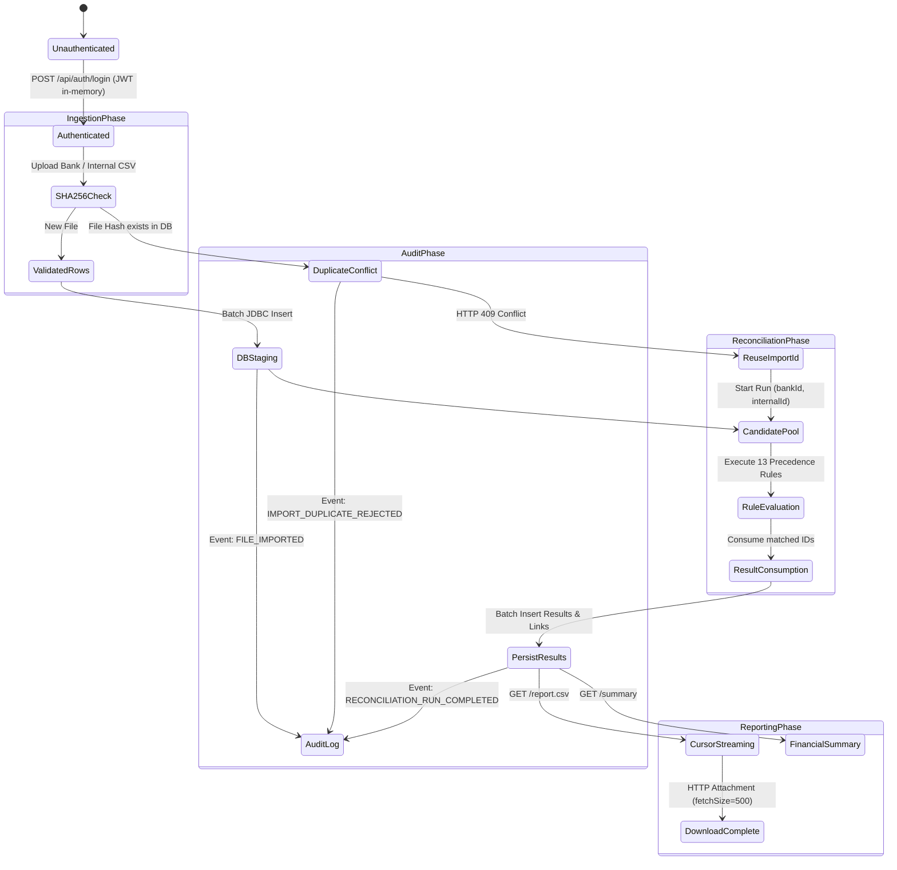
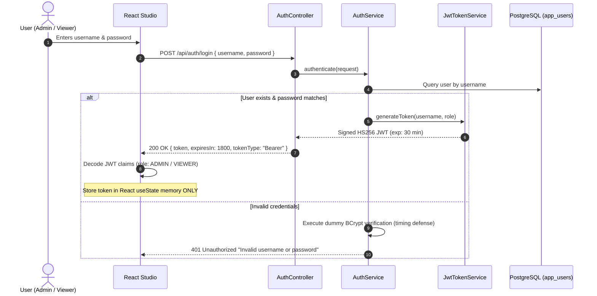
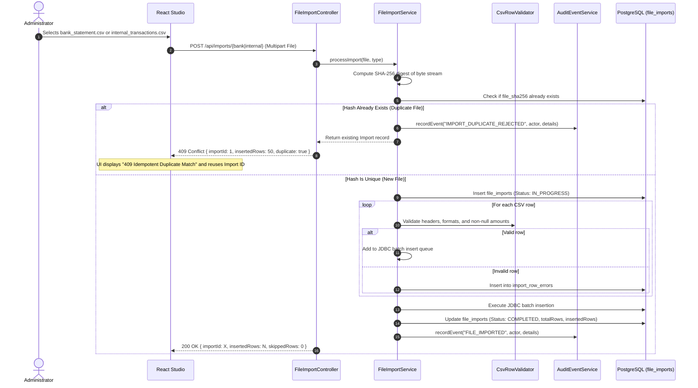
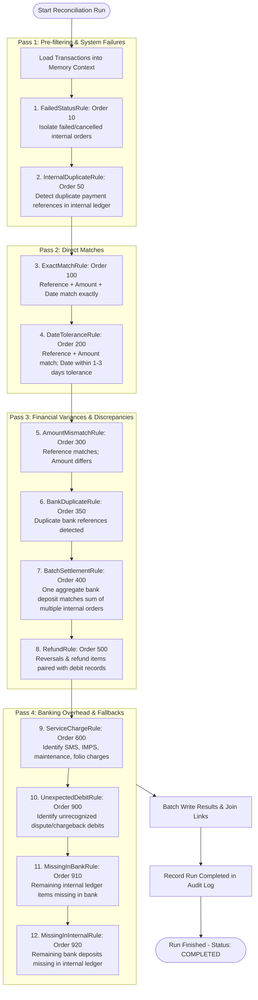
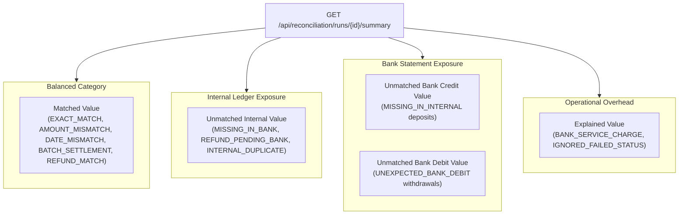
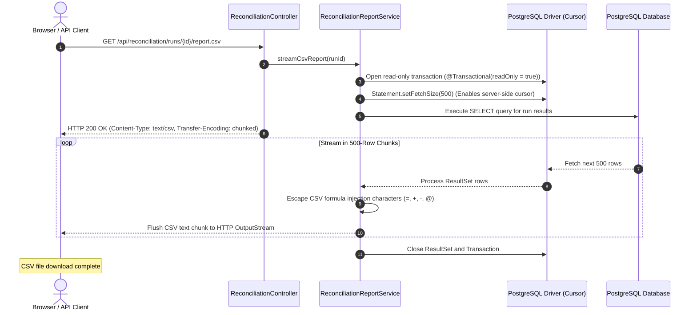

# ReconcileX - End-to-End Workflow & Execution Lifecycle

This document describes the operational workflows, data state transitions, and execution lifecycles across the **ReconcileX** system.

---

## 1. High-Level Master Workflow

The lifecycle of financial data in ReconcileX follows a 5-stage sequential workflow:



---

## 2. Stage 1: Authentication & Token Lifecycle Workflow

Every request to ReconcileX (except `/api/health` and OpenAPI docs) requires an active JWT token.



---

## 3. Stage 2: Idempotent File Ingestion Workflow

To protect financial ledgers from duplicate uploads or interrupted network transfers, files undergo SHA-256 content hashing before parsing.



---

## 4. Stage 3: Multi-Pass Deterministic Matching Workflow

When an administrator triggers a run with `bankImportId` and `internalImportId`, the engine executes all 13 rules in prioritized order:



### Candidate Consumption Mechanism
To guarantee deterministic execution and prevent duplicate counting:
* Every candidate has a unique tracking identifier.
* In every matching pass:
  ```java
  // Match found
  context.consumeInternal(matchedInternal.getId());
  context.consumeBank(matchedBank.getId());
  ```
* Subsequent rules are invoked only with the remaining candidate set.

---

## 5. Stage 4: Financial Discrepancy Reporting Workflow

ReconcileX calculates balance sheet discrepancies into clear economic categories:



---

## 6. Stage 5: Streaming CSV Export Workflow

To allow exporting 50,000+ row reconciliation reports without running out of JVM heap memory, ReconcileX streams database rows directly over HTTP:



---

## 7. Stage 6: Immutable Audit Trail Workflow

Compliance and audit requirements mandate that decision logs cannot be tampered with, even by administrators.

1. **Write Isolation (`Propagation.REQUIRES_NEW`):**
   * Audit events are committed in separate database transactions.
   * If a reconciliation run encounters a fatal error and rolls back, the `RUN_FAILED` audit record remains safely committed.
2. **PostgreSQL Trigger Security:**
   * An SQL trigger (`prevent_audit_modification`) prevents any `UPDATE` or `DELETE` statements on the `audit_events` table:
   ```sql
   CREATE TRIGGER trg_prevent_audit_modification
   BEFORE UPDATE OR DELETE ON audit_events
   FOR EACH ROW EXECUTE FUNCTION prevent_audit_modification();
   ```
3. **Traceability:**
   * Every audit log includes `runId`, `actor` (username or `system`), `eventType`, `details`, and an authoritative server timestamp (`occurred_at`).
