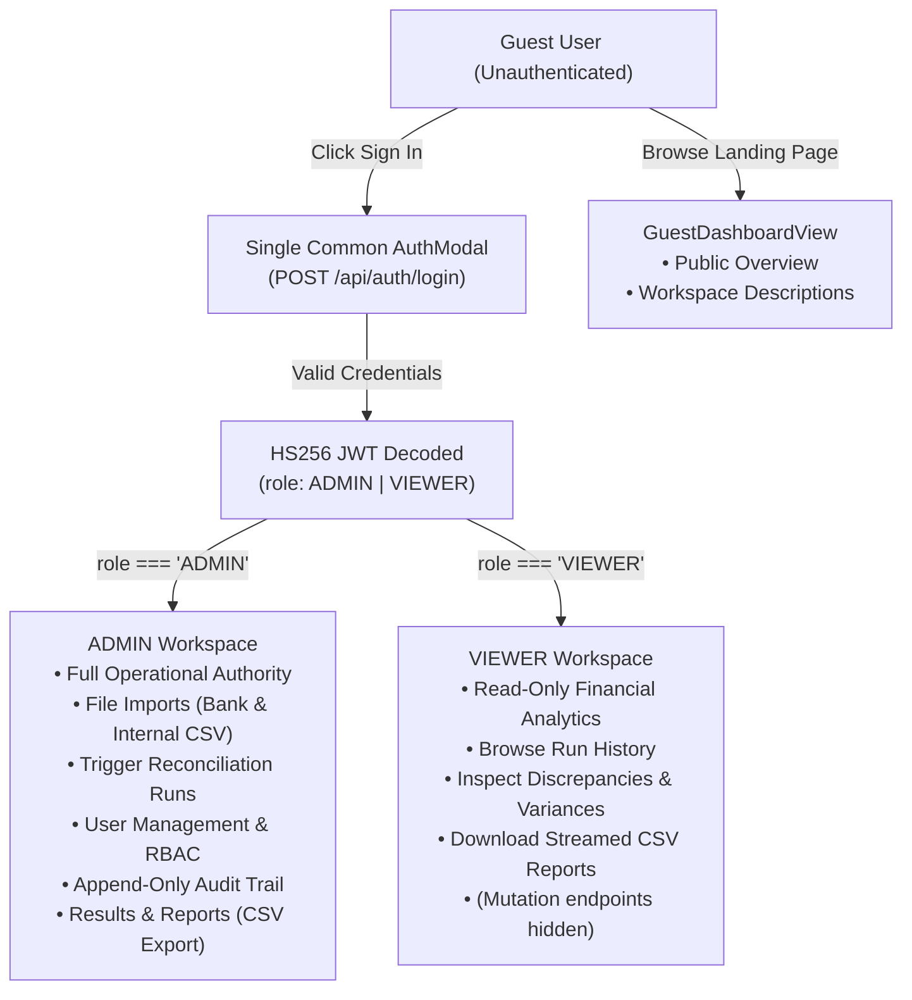

# ReconcileX — Frontend FinTech Studio

[](https://react.dev/)
[](https://tanstack.com/router)
[](https://tanstack.com/start)
[](https://tailwindcss.com/)
[](https://vitejs.dev/)
[](https://www.typescriptlang.org/)
[](https://vitest.dev/)

The ReconcileX frontend is an enterprise-grade financial reconciliation studio built with **React 19**, **TanStack Router**, **TanStack Start**, and **Tailwind CSS v4**. It delivers a high-density, dark navy fintech interface inspired by modern payment infrastructure consoles (Stripe, Ramp, Linear), engineered with zero simulated data, strict in-memory security, and complete mobile responsiveness.

---

## Table of Contents

1. [Key Architecture & Design Tenets](#1-key-architecture--design-tenets)
2. [Tech Stack Specifications](#2-tech-stack-specifications)
3. [Component Hierarchy & Source Structure](#3-component-hierarchy--source-structure)
4. [Role-Based Access Control (RBAC) & View Routing](#4-role-based-access-control-rbac--view-routing)
5. [In-Memory Security Architecture](#5-in-memory-security-architecture)
6. [Canonical Single Source of Truth (`matching-rules.ts`)](#6-canonical-single-source-of-truth-matching-rulests)
7. [Screen-by-Screen Feature Walkthrough](#7-screen-by-screen-feature-walkthrough)
8. [Mobile Responsiveness & Media Queries](#8-mobile-responsiveness--media-queries)
9. [Favicon Suite & Brand Assets](#9-favicon-suite--brand-assets)
10. [Local Development Quickstart](#10-local-development-quickstart)
11. [Vercel Production Deployment Guide](#11-vercel-production-deployment-guide)
12. [Testing & Quality Assurance](#12-testing--quality-assurance)

---

## 1. Key Architecture & Design Tenets

1. **Zero Client Storage Persistence (Anti-XSS):** JWT tokens and session data exist **only in React component state** (`useState`). Tokens are never written to `localStorage`, `sessionStorage`, or cookies. Refreshing the browser terminates the in-memory session cleanly.
2. **Canonical Domain Truth:** All rule order numbers, codes, labels, descriptions, CSV required headers, and audit event types are sourced from a single configuration file (`src/lib/matching-rules.ts`) that precisely mirrors the Spring Boot backend engine.
3. **Fact-Based Telemetry Only:** Status badges ("Engine Reachable" vs "Engine Unreachable") query real live endpoints (`GET /api/health`). Zero fabricated claims ("100% Operational", "Deterministic Ledger Verified") are used.
4. **Interactive Discrepancy Breakdown:** Results & Reports features a 5-card financial overview calculated strictly in INR, an interactive category distribution filter, and expandable transaction inspection.
5. **Universal Viewport Support:** Supports everything from 320px mobile screens (slide-out drawer with touch backdrop) up to 4K ultra-wide monitors.

---

## 2. Tech Stack Specifications

| Technology | Version | Purpose |
| :--- | :--- | :--- |
| **React** | 19.2.0 | Core UI library & hooks runtime |
| **TanStack Start** | 1.168.60 | Full-stack framework & Nitro SSR build pipeline |
| **TanStack Router** | 1.170.41 | Type-safe, file-based routing |
| **TanStack Query** | 5.101.1 | Server state caching & mutation synchronization |
| **Tailwind CSS** | 4.2.1 | Utility-first styling with custom OKLCH dark navy color palette |
| **Vite** | 8.1.5 | Lightning-fast HMR development server & asset bundler |
| **Nitro** | 3.0.260603 | Server runtime & Vercel Build Output API v3 packaging |
| **TypeScript** | 5.8.3 | End-to-end static typing in strict mode |
| **Vitest** | 4.1.12 | High-speed unit & integration test runner |
| **Lucide React** | 0.575.0 | Consistent iconography |
| **Radix UI** | Various | Headless, accessible UI primitives (Dialog, Select, Label) |

---

## 3. Component Hierarchy & Source Structure

```
frontend/
├── public/
│   ├── favicon.ico             # Multi-size ICO (16, 32, 48, 256 px)
│   ├── favicon.svg             # Crisp vector SVG favicon
│   ├── apple-touch-icon.png    # 180x180 iOS Home Screen touch icon
│   └── robots.txt              # Search engine crawler instructions
├── src/
│   ├── components/
│   │   ├── AdminDashboardView.tsx      # Admin overview, live engine health, recent runs, rule pipeline
│   │   ├── AuditView.tsx              # Append-only audit log viewer, JSON modal, event filters
│   │   ├── AuthModal.tsx              # Universal sign-in dialog (ADMIN & VIEWER, show/hide password)
│   │   ├── BackendHealthIndicator.tsx # Live GET /api/health polling status badge
│   │   ├── DashboardView.tsx          # Dynamic role dispatcher (Guest / Admin / Viewer)
│   │   ├── GuestDashboardView.tsx     # Public landing view: workspace permissions & platform overview
│   │   ├── ImportsView.tsx            # Bank & internal CSV ingestion with SHA-256 duplicate warning
│   │   ├── ResultsView.tsx            # Signature screen: 5 KPI cards, transaction table, export CSV
│   │   ├── RunsView.tsx               # Run trigger form (Admin), paginated runs history, per-run CSV
│   │   ├── SettingsView.tsx           # Platform architecture specifications & system constraints
│   │   ├── Sidebar.tsx                # Collapsible desktop sidebar & mobile slide-out drawer
│   │   ├── UserManagementView.tsx     # Provision accounts, real-time user list from DB, RBAC matrix
│   │   ├── ViewerDashboardView.tsx    # Viewer read-only dashboard with run history & analytics
│   │   └── ui/                        # Radix UI primitive wrappers (Button, Input, Dialog, etc.)
│   ├── lib/
│   │   ├── api.ts                     # Fetch client wrapper, dynamic VITE_API_URL, 401 interceptor
│   │   ├── auth-context.tsx           # AuthProvider: in-memory token state, 30-min countdown timer
│   │   ├── matching-rules.ts          # Single source of truth: 12 rules, CSV headers, audit events
│   │   ├── types.ts                   # Domain TypeScript interfaces (DTOs, summaries, users)
│   │   └── lovable-error-reporting.ts # Clean React error boundary exception logger
│   ├── routes/
│   │   ├── __root.tsx                 # Root layout: viewport meta, favicon links, AuthProvider
│   │   └── index.tsx                  # Master application shell: responsive navigation & tab switching
│   ├── test/
│   │   ├── content-accuracy.test.ts   # Unit tests for matching rules constants & CSV headers
│   │   ├── auth-and-rbac.test.ts      # Unit tests for JWT decode, role access gates, session timer
│   │   ├── app-routing.test.tsx       # Smoke test for root routing layout
│   │   └── setup.ts                   # Vitest DOM test environment setup
│   ├── router.tsx                     # TanStack Router instance creation
│   ├── server.ts                      # Nitro SSR server entry wrapper
│   ├── start.ts                       # Application bootstrap
│   └── styles.css                     # Global CSS tokens (OKLCH dark navy palette, animations)
├── package.json
├── tsconfig.json
├── vite.config.ts                     # Vite config with /api proxy & Nitro SSR entry
└── vitest.config.ts                   # Vitest testing configuration
```

---

## 4. Role-Based Access Control (RBAC) & View Routing

ReconcileX provides a unified, credential-driven experience where user roles are determined automatically after sign-in:



---

## 5. In-Memory Security Architecture

In accordance with institutional financial compliance standards:
- **No Local Storage:** The application never invokes `localStorage.setItem()` or `sessionStorage.setItem()`.
- **Memory-Bound Tokens:** The JWT token is passed directly into React `useState(token)`.
- **Automatic Session Expiry:** A countdown timer reads the `exp` claim from the JWT. At `exp - currentTime <= 0`, the token is nulled out, the user is switched back to the Guest state, and an expiration notification banner appears.
- **Global 401 Interceptor:** If the Spring Boot backend rejects any request with HTTP 401 (e.g. server restart or token invalidation), `api.ts` invokes `unauthorizedHandler()` which immediately triggers the re-authentication modal.

---

## 6. Canonical Single Source of Truth (`matching-rules.ts`)

To avoid drift between backend Java rules and frontend UI representations, [`src/lib/matching-rules.ts`](src/lib/matching-rules.ts) defines all domain constants once:

```typescript
// 12 sequential deterministic matching rules
export const MATCHING_RULES: readonly MatchingRuleDefinition[] = [ ... ];

// Exact 8-column header specification for Bank Statements
export const BANK_REQUIRED_HEADERS = [
  "transaction_date", "bank_reference", "payment_reference", "settlement_reference",
  "description", "credit_amount", "debit_amount", "currency"
] as const;

// Exact 8-column header specification for Internal Accounting Ledgers
export const INTERNAL_REQUIRED_HEADERS = [
  "transaction_id", "payment_reference", "transaction_date", "description",
  "amount", "currency", "payment_status", "settlement_reference"
] as const;

// 10 recorded compliance audit event types
export const AUDIT_EVENT_TYPES = [
  "RUN_STARTED", "RUN_COMPLETED", "RUN_FAILED",
  "IMPORT_STARTED", "IMPORT_COMPLETED", "IMPORT_FAILED",
  "IMPORT_DUPLICATE_REJECTED", "MATCH_DECISION",
  "USER_CREATED", "LOGIN_FAILED"
] as const;
```

---

## 7. Screen-by-Screen Feature Walkthrough

### 1. Guest Landing View (`GuestDashboardView.tsx`)
- High-impact hero section explaining multi-pass deterministic reconciliation.
- Side-by-side workspace permission comparison for `ADMIN` and `VIEWER`.
- Platform capabilities cards (Ledger Ingestion, Multi-Pass Pipeline, Variance Reports, Append-Only Audit Trail).

### 2. Admin Dashboard (`AdminDashboardView.tsx`)
- Real-time engine connectivity badge (`GET /api/health`).
- Key metrics: total recorded reconciliation runs, active session countdown.
- 6-module quick action grid to navigate directly to sub-systems.
- Recent runs ledger table with one-click result inspection.
- The 12-pass matching rules architecture panel.

### 3. Viewer Dashboard (`ViewerDashboardView.tsx`)
- Read-only analytics console showing total historical runs and latest completion status.
- Permissions context indicator confirming read-only clearance.
- Interactive run history table with results inspection and direct CSV download.

### 4. File Imports (`ImportsView.tsx`)
- Dual upload zones for Bank Statements and Internal Ledgers.
- Schema verification checking all 8 required headers.
- **SHA-256 Idempotency Feedback:** If a file was previously imported, displays `"Already imported as Import #N"` (HTTP 409) and prevents duplicate row insertion.
- Telemetry summary showing Total, Inserted, and Rejected row counts.

### 5. Reconciliation Runs (`RunsView.tsx`)
- **Admin Run Trigger:** Form accepting `Bank Import ID` and `Internal Import ID`.
- Real-time run execution with spinner and completion summary alert.
- Historical runs ledger showing data sources (`Bank #B • Internal #I`), timestamps, and status badges.
- Paginated table navigation with direct CSV report download buttons.

### 6. Results & Reports (`ResultsView.tsx` — Signature Screen)
- **Automatic Latest Run Resolution:** Automatically fetches and displays the latest completed run if no run ID was selected.
- **5-Card Financial KPI Rail:**
  1. *Matched Value* (Emerald)
  2. *Timing Variance* (Amber)
  3. *Unmatched Internal* (Rose)
  4. *Unmatched Bank Credit* (Rose)
  5. *Unmatched Bank Debit* (Rose)
- **Interactive Outcome Filter Ribbon:** Filter by outcome type (`EXACT_MATCH`, `DATE_MISMATCH`, etc.), date range (`From` / `To`), or text search.
- **Expandable Transaction Rows:** Click any row to reveal complete transaction explanations, Internal Tx IDs, and Bank Reference numbers.
- **Streaming CSV Export Button:** Downloads the official streaming CSV report directly from the backend.

### 7. Audit Trail (`AuditView.tsx`)
- Chronological append-only compliance ledger.
- Filter toolbar by `Run ID` and `Event Type` dropdown (10 official event types).
- Expandable JSON details row displaying structured payload metadata.

### 8. User Management (`UserManagementView.tsx`)
- Administrator form to provision new team accounts with `ADMIN` or `VIEWER` roles.
- Enforces strict backend validation (minimum 12-character passwords).
- Live user listing fetched directly from `GET /api/admin/users` (no fake local storage).
- Role-Based Access Control matrix table explaining exact permissions.

### 9. Platform Specifications (`SettingsView.tsx`)
- Technical specifications reference detailing engine architecture.
- 12-pass deterministic rule precedence order.
- CSV schema specifications and data-type constraints.
- In-memory token storage and PostgreSQL server-side cursor streaming policy.

---

## 8. Mobile Responsiveness & Media Queries

ReconcileX is built mobile-first using Tailwind CSS breakpoints:

| Viewport Breakpoint | Target Screen Sizes | Responsive Adaptations |
| :--- | :--- | :--- |
| **Mobile (`< 640px`)** | Phones (320px–425px) | Hamburger button (`Menu`), slide-out drawer with touch backdrop, 1-column card stacking, full-width inputs, touch-swipable tables (`overflow-x-auto`). |
| **Small (`sm: ≥ 640px`)** | Phablets & small tablets | 2-column KPI grids, inline action ribbons, compact button clusters. |
| **Medium (`md: ≥ 768px`)** | Tablets & iPads | Persistent sidebar navigation unlocked, desktop header elements displayed. |
| **Large (`lg: ≥ 1024px`)** | Laptops & Desktops | Multi-column workstations (e.g. 8-column transaction table + 4-column sticky analytics rail, 5-column financial metrics). |

---

## 9. Favicon Suite & Brand Assets

The custom ReconcileX dark fintech brand icon is located in `public/`:
- **[`favicon.svg`](public/favicon.svg):** Scalable vector icon with deep navy rounded canvas, indigo "RX" monogram, and reconciliation balance bar.
- **[`favicon.ico`](public/favicon.ico):** Multi-resolution binary ICO containing 16x16, 32x32, 48x48, and 256x256 embedded bitmaps for taskbars and legacy browsers.
- **[`apple-touch-icon.png`](public/apple-touch-icon.png):** 180x180 high-resolution PNG for iOS Home Screen bookmarks.

---

## 10. Local Development Quickstart

### Prerequisites
- **Node.js 20+**
- **pnpm** (recommended package manager)

```powershell
# 1. Navigate to the frontend directory:
cd reconcilex\frontend

# 2. Install dependencies:
pnpm install

# 3. Start the Vite development server:
pnpm run dev
```

The studio starts on **`http://localhost:8082`**. All requests matching `/api/*` are automatically reverse-proxied to `http://localhost:8081` (Spring Boot backend).

### Available Scripts

| Script | Command | Purpose |
| :--- | :--- | :--- |
| `pnpm run dev` | `vite dev` | Start development server with hot-module replacement |
| `pnpm run build` | `vite build` | Compile client bundle, SSR server, and Nitro output |
| `pnpm run preview` | `vite preview` | Locally preview the built production bundle |
| `pnpm test` | `vitest run` | Execute the Vitest test suite once |
| `pnpm test:watch` | `vitest` | Run tests in interactive watch mode |
| `pnpm exec tsc --noEmit` | `tsc --noEmit` | Run strict TypeScript compiler verification |
| `pnpm run lint` | `eslint .` | Verify code quality with ESLint |
| `pnpm run format` | `prettier --write .` | Format codebase with Prettier |

---

## 11. Vercel Production Deployment Guide

The ReconcileX frontend is configured for deployment to **Vercel** using Nitro's Build Output API v3.

### 1. Connect Repository to Vercel
1. Log in to [Vercel](https://vercel.com) and click **Add New...** → **Project**.
2. Select your `ReconcileX` GitHub repository.

### 2. Configure Project Settings
- **Framework Preset:** `Other` (or TanStack Start / Nitro).
- **Root Directory:** Click **Edit** and set to **`frontend`**.
- **Build Command:** `pnpm run build`
- **Output Directory:** Leave blank (Nitro automatically outputs to `.vercel/output`).
- **Install Command:** `pnpm install`

### 3. Configure Environment Variables
Under **Environment Variables**, add:

| Name | Value | Purpose |
| :--- | :--- | :--- |
| `VITE_API_URL` | `https://your-backend.onrender.com` | Base URL of your deployed Spring Boot backend (no trailing slash). |
| `NITRO_PRESET` | `vercel` | Explicitly enforces the Vercel serverless build output preset. |

### 4. Deploy
Click **Deploy**. Vercel compiles the static assets into `.vercel/output/static` and the SSR server into `.vercel/output/functions/__server.func`, deploying them globally across Vercel's Edge network.

---

## 12. Testing & Quality Assurance

### Vitest Test Suites (17 / 17 Tests Passing)
Run all frontend test suites:
```powershell
pnpm test
```

- **`src/test/content-accuracy.test.ts` (5 tests):** Validates that all 12 matching rules, 8 required bank headers, 8 required internal headers, and 10 audit event types match the backend single source of truth.
- **`src/test/auth-and-rbac.test.ts` (11 tests):** Validates client-side JWT payload decoding, role permissions gating (`ADMIN` vs `VIEWER`), and session countdown math.
- **`src/test/app-routing.test.tsx` (1 test):** Smoke test ensuring the root router and route tree render without crashes.

### TypeScript Strictness
```powershell
pnpm exec tsc --noEmit
```
Compiles with **0 errors**, enforcing strict type safety across all components and API contracts.
